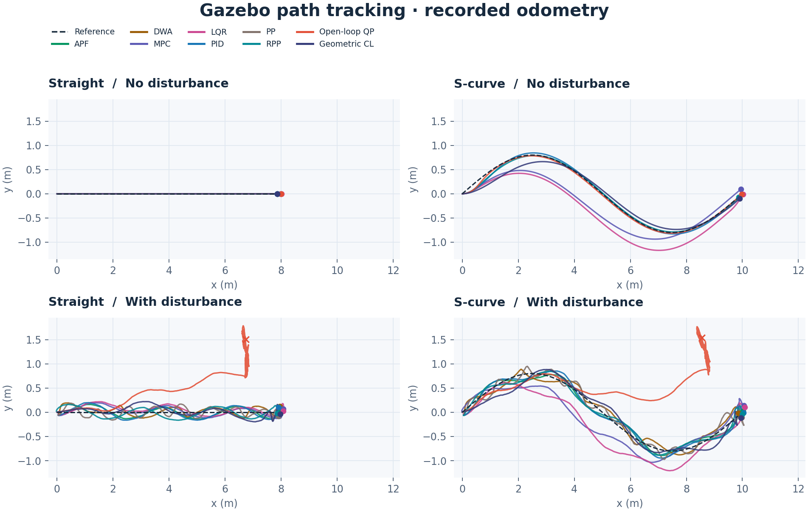
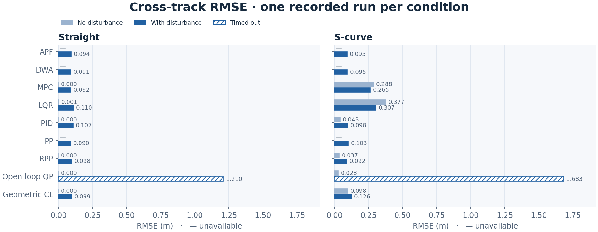

# Path Tracking Benchmarks

[简体中文](README_CN.md) · [中文项目分析](docs/project-analysis.zh-CN.md)

[](https://index.ros.org/d/noetic/)
[](https://isocpp.org/std/status)
[](https://www.python.org/)
[](LICENSE)
[](pp_controller/LICENSE)
[](open_loop_qp_controller/LICENSE)

Eight ROS 1 packages for following planar paths with a mobile robot. The Python package contains two methods: an odometry-based geometric tracker and a one-shot open-loop speed QP. Both send the same velocity messages as the seven C++ trackers. Each controller has its own launch file and parameters, so a simulator can switch methods while keeping the ROS messages and topics the same.

## Controllers and control laws

| Controller | How this implementation computes a command |
| --- | --- |
| [APF](apf_controller/) | Steers toward the lookahead point and adds a correction for the path tangent. |
| [DWA](dwa_controller/) | Samples an acceleration-limited velocity window and scores short rollouts for path error, heading and forward speed. |
| [MPC](mpc_controller/) | Evaluates a grid of constant speed pairs against a sequence of future reference poses, then repeats the search with updated odometry. |
| [LQR](lqr_controller/) | Uses a fixed gain from a discrete Riccati iteration and a curvature-based feedforward command. |
| [Open-loop QP](open_loop_qp_controller/) | Solves for waypoint speeds once and plays the resulting sequence. |
| [Geometric tracker](open_loop_qp_controller/) | Projects the current pose onto the path, selects a fixed-distance lookahead point and smooths speed and yaw-rate commands. |
| [PID](pid_controller/) | Maps proportional position error to velocity through inverse kinematics. |
| [PP](pp_controller/) | Graceful Pure Pursuit computes curvature from the target distance and two bearing angles. |
| [RPP](rpp_controller/) | Adapts lookahead to the measured speed, then regulates velocity for curvature, goal approach and optional scan data. |

Here $p_t$ is the lookahead point, $\theta$ is robot heading, $\alpha$ is the wrapped heading error to the lookahead point, and $v,\omega$ are the forward and angular commands. APF adds the tangent error $e_t$ to the attraction and averages the saturated steering command.

$$
U(p)=\frac{1}{2}\left\Vert p-p_t\right\Vert^2,\qquad
\omega=\mathrm{mean}\left(\mathrm{sat}\left(k_h\alpha+0.35\,e_t\right)\right)
$$

DWA bounds the next command relative to the previous one. MPC scores predicted positions and headings over $N$ steps. LQR corrects around a reference input based on the measured speed $v_t$ and reference curvature $\kappa_r$.

$$
\begin{aligned}
\mathrm{DWA:}\quad & |v-v_-|\le a_v\Delta t,\quad |\omega-\omega_-|\le a_\omega\Delta t,\\
\mathrm{MPC:}\quad & J=\sum_{k=0}^{N-1}(1+0.3k)\left(w_p\left\Vert e_{p,k}\right\Vert^2+w_\theta e_{\theta,k}^2\right)+w_vv^2+w_\omega\omega^2,\\
\mathrm{LQR:}\quad & u=u_r+Ke,\quad u_r=(v_t,v_t\kappa_r)^\top .
\end{aligned}
$$

Open-loop QP fits a speed profile with speed and speed-difference bounds. The PID package uses only the proportional term with body-frame error $e_b$ and control-point offset $L$.

$$
\begin{aligned}
\mathrm{QP:}\quad & \min_v\ w_v\sum_i(v_i-v_i^{\mathrm{ref}})^2+w_d\sum_i(v_{i+1}-v_i)^2,\\
\mathrm{PID:}\quad & e_b=R(-\theta)(p_t-p),\quad v=k e_{b,x},\quad\omega=k e_{b,y}/L.
\end{aligned}
$$

PP uses curvature to reduce cruise speed. RPP makes the lookahead distance speed-dependent. The geometric tracker fixes $L_d$, then applies acceleration and yaw-rate slew limits.

$$
\begin{aligned}
\mathrm{PP:}\quad & v_\kappa=\frac{v_{\max}}{1+\beta|\kappa|^\lambda},\quad \omega=v\kappa,\\
\mathrm{RPP:}\quad & L_d=\mathrm{clip}(|v_t|T,L_{\min},L_{\max}),\quad \kappa=\frac{2\sin\alpha}{L_d},\\
\mathrm{Geometric:}\quad & \kappa=\mathrm{clip}\left(\frac{2\sin\alpha}{L_d},-\frac{1}{R_{\min}},\frac{1}{R_{\min}}\right),
\quad \omega_{\mathrm{ref}}=v\kappa.
\end{aligned}
$$

## Gazebo comparison

Dots mark the final odometry position for runs that reached the goal. Crosses mark timeouts. Both figures use saved Gazebo runs on the same straight and S-curve references.





The eight closed-loop methods reached the goal in both recorded disturbed runs. Open-loop QP timed out in those runs, with cross-track RMSE of 1.210 m on the straight and 1.683 m on the S-curve. Without disturbance, the same QP reached both goals, with 0.000 m and 0.028 m RMSE at the displayed precision. There is one run per available case. [Benchmark notes and metrics](controller_benchmark/README.md)

## Build and run

Use Ubuntu 20.04 with an existing [ROS 1 Noetic](https://index.ros.org/d/noetic/) installation. Noetic reached upstream end of life on May 31, 2025. [ROS release notice](https://discourse.openrobotics.org/t/new-packages-for-noetic-2025-05-29-final/44003)

From the root of a local checkout, link it into a catkin workspace. If rosdep has never been initialized on the machine, first run `sudo rosdep init`.

```bash
source /opt/ros/noetic/setup.bash
mkdir -p ~/tracking_ws/src
ln -s "$PWD" ~/tracking_ws/src/Path-Tracking-Benchmarks
cd ~/tracking_ws
rosdep update --include-eol-distros
rosdep install --from-paths src --ignore-src --rosdistro noetic -r -y
catkin_make
source devel/setup.bash
```

The C++ nodes use a C++17 compiler, catkin, `roscpp`, the ROS message packages, and TF. LQR uses Eigen3. The QP node uses Python 3, `rospy`, NumPy, SciPy and OSQP 1.x. The closed-loop geometric tracker uses Python 3 and rospy. Install OSQP into the Python environment used by catkin for the open-loop mode.

```bash
sudo apt install python3-pip
python3 -m pip install --user 'osqp>=1.0,<2'
```

For a quick local run, open two terminals and source `~/tracking_ws/devel/setup.bash` in both. The demo publishes a synthetic path and integrates commands with the planar kinematic model.

```bash
# Terminal 1
roslaunch rpp_controller rpp_controller.launch

# Terminal 2
python3 ~/tracking_ws/src/Path-Tracking-Benchmarks/examples/kinematic_demo.py --path s-curve
```

Inspect commands with `rostopic echo /cmd_vel`, or use `rostopic echo /odom1/pose/pose` to see the demo pose move. Stop the active controller and restart the demo to reset the initial pose before switching controllers.

The Python package has two launch files. Start one at a time.

```bash
# Closed-loop geometric tracking with odometry
roslaunch open_loop_qp_controller geometric_tracking_controller.launch

# Open-loop speed QP
roslaunch open_loop_qp_controller open_loop_qp_controller.launch
```

Restart the QP node for each new path. Both launch files accept `plan_topic` and `cmd_vel_topic`. The geometric tracker also accepts `odom_topic`.

| Topic | Type | Role |
| --- | --- | --- |
| `/plan` | `nav_msgs/Path` | Reference path |
| `/odom1` | `nav_msgs/Odometry` | Current pose and velocity for closed-loop methods |
| `/cmd_vel` | `geometry_msgs/Twist` | Command in `linear.x` and `angular.z` |
| `/local_path` | `nav_msgs/Path` | Path segment for diagnostics, or the full plan for QP |
| `/controller_solve_time_ms` | `std_msgs/Float64` | Per-cycle computation time for closed-loop nodes, one planning time for QP |

The path and odometry poses must be expressed in the same frame, `map` by default. Launch arguments let you remap `plan_topic`, `cmd_vel_topic` and, for C++ nodes, `odom_topic`. Enable RViz with `rviz:=true` on a C++ launch or run it separately. Keep one controller publishing to each command topic.

## References and acknowledgments

- R. Craig Coulter, *Implementation of the Pure Pursuit Path Tracking Algorithm*, 1992. [CMU Robotics Institute](https://www.ri.cmu.edu/publication_view.html?pub_id=278)
- Oussama Khatib, *Real-Time Obstacle Avoidance for Manipulators and Mobile Robots*, 1986. [Paper](https://journals.sagepub.com/doi/10.1177/027836498600500106)
- Dieter Fox, Wolfram Burgard and Sebastian Thrun, *The Dynamic Window Approach to Collision Avoidance*, 1997. [Paper](https://doi.org/10.1109/100.580977)
- Jong Jin Park and Benjamin Kuipers, *A Smooth Control Law for Graceful Motion of Differential Wheeled Mobile Robots in 2D Environments*, 2011. The PP package adapts code from Robot-Nav. [Paper](https://web.eecs.umich.edu/~kuipers/papers/Park-icra-11.pdf) · [Robot-Nav/PP_Controller](https://github.com/Robot-Nav/PP_Controller)
- Steve Macenski et al., *Regulated Pure Pursuit for Robot Path Tracking*. [Paper](https://arxiv.org/abs/2305.20026)

Thanks to the maintainers of ROS, Gazebo, Eigen, NumPy, SciPy and OSQP. See [license scope](LICENSING.md) for the terms that apply to each package.
