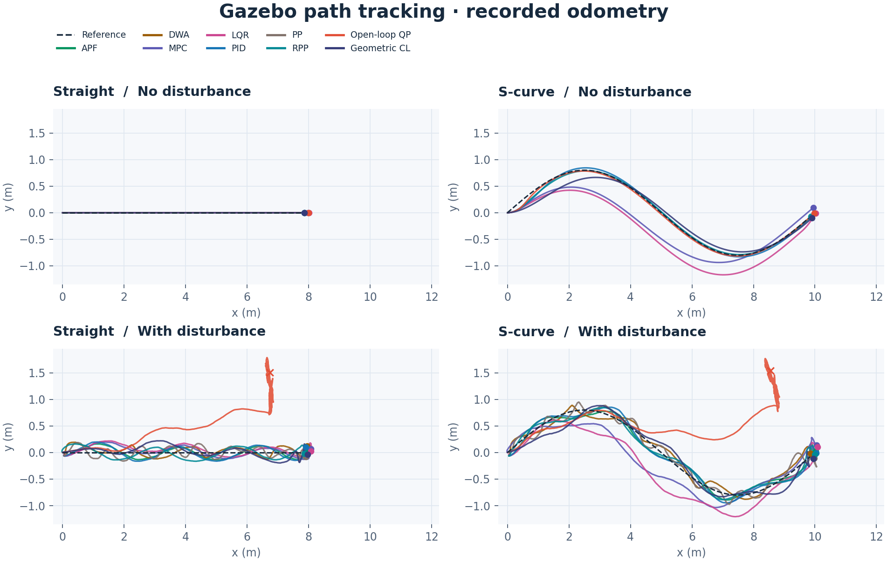
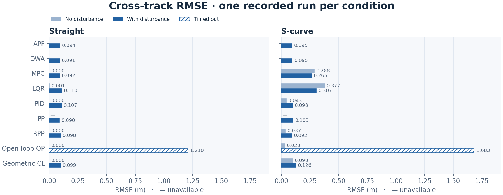

# 路径跟踪基准对比

[English](README.md) · [中文项目分析](docs/project-analysis.zh-CN.md)

[](https://index.ros.org/d/noetic/)
[](https://isocpp.org/std/status)
[](https://www.python.org/)
[](LICENSE)
[](pp_controller/LICENSE)
[](open_loop_qp_controller/LICENSE)

同一条路径交给不同控制器，差异通常从入弯、扰动后的纠偏和终点停车开始显现。仓库有八个 catkin 包，统一使用 ROS 1 路径和速度消息。七个 C++ 包各实现一种闭环方法，Python 包同时提供带里程计反馈的几何跟踪和起步前求解一次的开环 QP。

## 控制器与公式

| 控制器 | 实现原理 |
| --- | --- |
| [APF 人工势场](apf_controller/) | 朝前瞻点转向，并用路径切向修正航向。 |
| [DWA 动态窗口](dwa_controller/) | 在加速度可达的速度窗口内采样，按路径误差、航向和前进速度给预测轨迹打分。 |
| [MPC 模型预测控制](mpc_controller/) | 用速度网格搜索匹配多个未来参考位姿，每周期读取最新里程计重新搜索。 |
| [LQR 线性二次调节](lqr_controller/) | 在简化线性模型上用离散 Riccati 迭代求固定反馈增益，并加入曲率前馈。 |
| [开环 QP](open_loop_qp_controller/) | 在起步前优化各路径点速度，随后按时间播放指令序列。 |
| [闭环几何跟踪](open_loop_qp_controller/) | 用里程计投影到路径，按固定前瞻距离选点，再平滑线速度与角速度指令。 |
| [PID](pid_controller/) | 将车体坐标系下的比例位置误差通过逆运动学映射为速度。 |
| [PP 平滑纯追踪](pp_controller/) | 根据目标距离和两个视线夹角计算曲率。 |
| [RPP 调节型纯追踪](rpp_controller/) | 按实测速度调整前瞻距离，结合曲率、终点距离和可选激光数据调节速度。 |

记 $p_t$ 为前瞻点，$\theta$ 为车体航向，$\alpha$ 为前瞻点相对车头的夹角，$v,\omega$ 为前向速度和角速度。APF 把路径切向偏差 $e_t$ 加入转向控制，再对限幅后的角速度取滑动平均。

$$
U(p)=\frac{1}{2}\left\Vert p-p_t\right\Vert^2,\qquad
\omega=\mathrm{mean}\left(\mathrm{sat}\left(k_h\alpha+0.35\,e_t\right)\right)
$$

DWA 按上一周期指令限制采样范围。MPC 评价 $N$ 步的预测位置与航向。LQR 以实测速度 $v_t$ 和参考曲率 $\kappa_r$ 计算前馈，并叠加反馈。

$$
\begin{aligned}
\mathrm{DWA:}\quad & |v-v_-|\le a_v\Delta t,\quad |\omega-\omega_-|\le a_\omega\Delta t,\\
\mathrm{MPC:}\quad & J=\sum_{k=0}^{N-1}(1+0.3k)\left(w_p\left\Vert e_{p,k}\right\Vert^2+w_\theta e_{\theta,k}^2\right)+w_vv^2+w_\omega\omega^2,\\
\mathrm{LQR:}\quad & u=u_r+Ke,\quad u_r=(v_t,v_t\kappa_r)^\top .
\end{aligned}
$$

开环 QP 优化参考速度并限制相邻点速度差。PID 包当前使用比例项，通过车体坐标误差 $e_b$ 与控制点偏移 $L$ 计算指令。

$$
\begin{aligned}
\mathrm{QP:}\quad & \min_v\ w_v\sum_i(v_i-v_i^{\mathrm{ref}})^2+w_d\sum_i(v_{i+1}-v_i)^2,\\
\mathrm{PID:}\quad & e_b=R(-\theta)(p_t-p),\quad v=k e_{b,x},\quad\omega=k e_{b,y}/L.
\end{aligned}
$$

PP 在弯道按曲率降速。RPP 用当前速度决定前瞻距离。闭环几何跟踪使用固定 $L_d$，并对加速度和角速度变化做平滑。

$$
\begin{aligned}
\mathrm{PP:}\quad & v_\kappa=\frac{v_{\max}}{1+\beta|\kappa|^\lambda},\quad \omega=v\kappa,\\
\mathrm{RPP:}\quad & L_d=\mathrm{clip}(|v_t|T,L_{\min},L_{\max}),\quad \kappa=\frac{2\sin\alpha}{L_d},\\
\mathrm{Geometric:}\quad & \kappa=\mathrm{clip}\left(\frac{2\sin\alpha}{L_d},-\frac{1}{R_{\min}},\frac{1}{R_{\min}}\right),
\quad \omega_{\mathrm{ref}}=v\kappa.
\end{aligned}
$$

## Gazebo 对比

虚线是参考路径，圆点表示到达试验终点时的里程计位置，叉号表示超时试验的最后位置。两张图来自同一批已保存的 Gazebo 里程计及评测记录。





这批记录中，八种闭环方法在两条受扰路径上均到达。开环 QP 在无扰动的直线、S 弯分别得到 0.000 m 和 0.028 m RMSE（显示精度），开启扰动后两组均超时，RMSE 分别为 1.210 m 和 1.683 m。每个可用组合只展示一次运行。 [试验说明与汇总数据](controller_benchmark/README.md)

## 编译与运行

环境为 Ubuntu 20.04 和已安装的 [ROS 1 Noetic](https://index.ros.org/d/noetic/)。Noetic 的上游维护已于 2025 年 5 月 31 日结束。 [ROS 发布公告](https://discourse.openrobotics.org/t/new-packages-for-noetic-2025-05-29-final/44003)

在本地仓库根目录执行下面的命令。机器首次使用 rosdep 时，先运行 `sudo rosdep init`。

```bash
source /opt/ros/noetic/setup.bash
mkdir -p ~/tracking_ws/src
ln -s "$PWD" ~/tracking_ws/src/Path-Tracking-Benchmarks
cd ~/tracking_ws
rosdep update --include-eol-distros
rosdep install --from-paths src --ignore-src --rosdistro noetic -r -y
catkin_make
source devel/setup.bash
```

C++ 节点依赖 C++17 编译器、catkin、`roscpp`、ROS 消息包和 TF，LQR 还需要 Eigen3。开环 QP 使用 Python 3、`rospy`、NumPy、SciPy 和 OSQP 1.x。闭环几何跟踪使用 Python 3 和 rospy。运行开环模式时，将 OSQP 安装到 catkin 使用的 Python 环境中。

```bash
sudo apt install python3-pip
python3 -m pip install --user 'osqp>=1.0,<2'
```

打开两个终端，各自执行 `source ~/tracking_ws/devel/setup.bash`。示例会发布合成路径，并按平面运动学积分速度指令。

```bash
# 终端 1
roslaunch rpp_controller rpp_controller.launch

# 终端 2
python3 ~/tracking_ws/src/Path-Tracking-Benchmarks/examples/kinematic_demo.py --path s-curve
```

用 `rostopic echo /cmd_vel` 查看速度指令，用 `rostopic echo /odom1/pose/pose` 查看示例中的位姿变化。切换控制器前先停止当前控制器，并重启示例以恢复初始位姿。

Python 包提供两个启动入口，每次选择一个运行。

```bash
# 闭环几何跟踪，读取里程计
roslaunch open_loop_qp_controller geometric_tracking_controller.launch

# 开环速度 QP
roslaunch open_loop_qp_controller open_loop_qp_controller.launch
```

更换开环参考路径时重启 QP 节点。两个入口都接受 `plan_topic` 和 `cmd_vel_topic`，闭环入口还接受 `odom_topic`。

| 默认话题 | 消息类型 | 用途 |
| --- | --- | --- |
| `/plan` | `nav_msgs/Path` | 参考路径 |
| `/odom1` | `nav_msgs/Odometry` | 闭环方法使用的位姿和速度 |
| `/cmd_vel` | `geometry_msgs/Twist` | `linear.x` 为前向速度，`angular.z` 为偏航角速度 |
| `/local_path` | `nav_msgs/Path` | 用于观察的局部路径，QP 发布完整的输入路径 |
| `/controller_solve_time_ms` | `std_msgs/Float64` | 闭环方法每周期的计算时间，QP 发布一次规划时间 |

路径和里程计位姿须事先统一到同一个坐标系，默认是 `map`。可用启动参数 `plan_topic`、`cmd_vel_topic` 和 C++ 节点的 `odom_topic` 适配已有 ROS 系统。C++ 启动文件支持 `rviz:=true`。同一条指令话题只运行一个控制器。

## 参考文献与致谢

- R. Craig Coulter，*Implementation of the Pure Pursuit Path Tracking Algorithm*，1992。 [CMU Robotics Institute](https://www.ri.cmu.edu/publication_view.html?pub_id=278)
- Oussama Khatib，*Real-Time Obstacle Avoidance for Manipulators and Mobile Robots*，1986。 [论文](https://journals.sagepub.com/doi/10.1177/027836498600500106)
- Dieter Fox、Wolfram Burgard 和 Sebastian Thrun，*The Dynamic Window Approach to Collision Avoidance*，1997。 [论文](https://doi.org/10.1109/100.580977)
- Jong Jin Park 和 Benjamin Kuipers，*A Smooth Control Law for Graceful Motion of Differential Wheeled Mobile Robots in 2D Environments*，2011。PP 包基于 Robot-Nav 的实现移植。 [论文](https://web.eecs.umich.edu/~kuipers/papers/Park-icra-11.pdf) · [Robot-Nav/PP_Controller](https://github.com/Robot-Nav/PP_Controller)
- Steve Macenski 等，*Regulated Pure Pursuit for Robot Path Tracking*。 [论文](https://arxiv.org/abs/2305.20026)

感谢 ROS、Gazebo、Eigen、NumPy、SciPy 和 OSQP 的维护者。各包适用的许可证见 [许可范围](LICENSING.md)。
