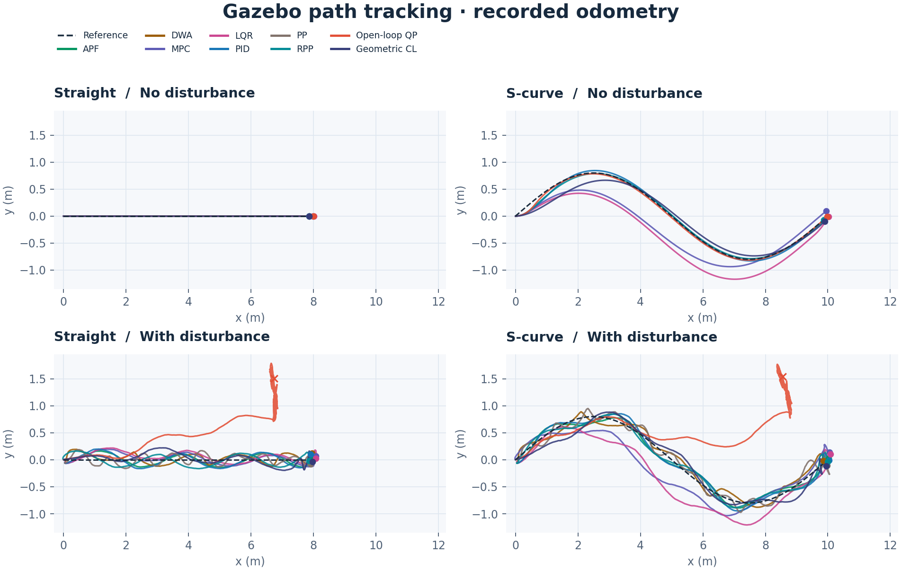
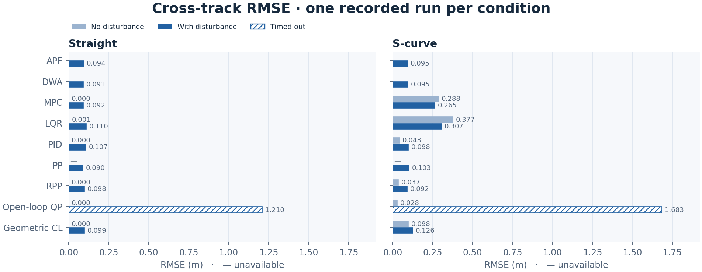

# 八个 ROS 1 路径跟踪包与九种控制方法

[中文版 README](../README_CN.md) · [English README](../README.md) · [Gazebo 指标](../controller_benchmark/metrics.csv)

一辆车已经有了参考路径，接下来要决定每一时刻的线速度和角速度。几种方法在直线上可能走得几乎一样。入弯后，前瞻点怎么选、角速度怎么限，差异马上可见。再施加扰动，开环速度序列和有里程计反馈的控制器便走出两类轨迹。

## 运动学与接口

设状态 $q=(x,y,\theta)^\top$、指令 $u=(v,\omega)^\top$。参考路径和里程计位姿使用同一个坐标系。指令通过 ROS 的 `geometry_msgs/Twist` 发布，取 `linear.x` 和 `angular.z`。

$$
\dot x=v\cos\theta,\qquad \dot y=v\sin\theta,\qquad \dot\theta=\omega
$$

多数实现先裁剪当前位置附近的参考路径，再选前瞻点或参考位姿。C++ 节点用 $\lvert\omega\rvert\le\min(\omega_{\max},v/R_{\min})$ 限制最终角速度。速度接近零时，可用的转向幅度也随之缩小。

## 控制律

### APF：向前瞻点靠拢

设 $p_t$ 为前瞻点，二次势场 $U(p)=\frac12\lVert p-p_t\rVert^2$ 的负梯度指向 $p_t$。以 $\alpha$ 表示视线方向与航向的偏差，$e_t$ 表示路径切向与航向的偏差。实现对限幅后的角速度做滑动平均，并在偏航角较大或目标较近时降速。

$$
\omega=\mathrm{mean}(\mathrm{sat}(k_h\alpha+0.35e_t)),\qquad
v=\mathrm{clip}\left(v_{\max}[\cos\alpha]_0^1
 \left[\frac{\lVert p_t-p\rVert}{L_d}\right]_0^1,v_{\min},v_{\max}\right)
$$

$[\cdot]_0^1$ 表示裁剪到 $[0,1]$。这一实现使用吸引项来跟踪路径。 [APF 源码](../apf_controller/) · [Khatib 的势场论文](https://journals.sagepub.com/doi/10.1177/027836498600500106)

### DWA：在速度窗口里做短时预测

以上一周期指令 $(v_-,\omega_-)$ 为中心，用 $\lvert v-v_-\rvert\le a_v\Delta t$、$\lvert\omega-\omega_-\rvert\le a_\omega\Delta t$ 约束候选范围，并过滤不满足转弯半径的速度对。对每条预测轨迹，$\bar d$ 和 $d_N$ 分别为平均和终端路径误差，$d_t$ 为终端到前瞻点的距离，$e_N,e_t$ 为终端航向相对两处路径切向的偏差。

$$
S=0.25\,v/v_{\max}-2.5\,\bar d-2\,d_N-0.7\,d_t-0.8\lvert e_N\rvert-0.25\lvert e_t\rvert
$$

每周期选择得分最高的速度对。这里使用路径代价。 [DWA 源码](../dwa_controller/) · [Fox 等人的 DWA 论文](https://doi.org/10.1109/100.580977)

### MPC：针对多个未来参考点算代价

对每个候选 $(v,\omega)$，用当前位姿向前积分 $N$ 步，在各步与参考位姿比较。位置误差为 $e_{p,k}$，航向误差为 $e_{\theta,k}$。

$$
J=\sum_{k=0}^{N-1}(1+0.3k)(w_p\lVert e_{p,k}\rVert^2+w_\theta e_{\theta,k}^2)
+w_v v^2+w_\omega\omega^2
$$

实现让同一对速度在预测域内保持常值，并在下一周期用新状态重新搜索。前瞻距离、预测步数和加速度窗口共同决定可选轨迹。 [MPC 源码](../mpc_controller/)

### LQR：用离散 Riccati 迭代求反馈增益

前瞻点和切向航向给出 $q_r$，其曲率近似为 $\kappa_r$，里程计速度为 $v_t$。取 $e=q-q_r$ 和 $u_r=(v_t,v_t\kappa_r)^\top$，模型用 $A=I_3$、$B=\Delta t\begin{bmatrix}1&0\\0&0\\0&1\end{bmatrix}$。

$$
P^+=Q+A^\top PA-A^\top PB(R+B^\top PB)^{-1}B^\top PA
$$

$$
K=-(R+B^\top PB)^{-1}B^\top PA,\qquad u=u_r+Ke
$$

这一固定线性模型没有横向误差到控制量的直接耦合，弯道主要依赖曲率前馈和航向修正。 [LQR 源码](../lqr_controller/)

### PID：逆运动学映射位置误差

把前瞻点位置误差旋转到车体坐标系，再用控制点偏移 $L$ 将横向分量映射成角速度。

$$
e_b=R(-\theta)(p_t-p),\qquad v=k e_{b,x},\qquad
\omega=k e_{b,y}/L
$$

包名沿用 PID，当前只用比例项。减小 $L$ 会放大相同横向误差产生的角速度，输出还要经过限幅。 [PID 源码](../pid_controller/)

### PP：同时看目标位置和朝向

令 $r$ 为目标距离，$\psi$ 为视线方向，$\phi=\mathrm{wrap}(\theta_t-\psi)$，$\delta=\mathrm{wrap}(\theta-\psi)$。Graceful Pure Pursuit 把目标朝向与当前朝向一起用于计算曲率。

$$
\kappa=-\frac{1}{r}\left[k_\delta(\delta-\arctan(-k_\phi\phi))
+\left(1+\frac{k_\phi}{1+(k_\phi\phi)^2}\right)\sin\delta\right],\qquad
v_\kappa=\frac{v_{\max}}{1+\beta\lvert\kappa\rvert^\lambda}
$$

进入减速区后再缩放线速度，角速度按 $\omega=v\kappa$ 计算并限幅。 [PP 源码](../pp_controller/) · [Park 与 Kuipers 的控制律推导](https://web.eecs.umich.edu/~kuipers/papers/Park-icra-11.pdf)

### RPP：根据速度调整前瞻距离

RPP 根据当前速度 $v_t$ 调整前瞻距离，曲率较大时降低线速度，随后再考虑终点距离。

$$
L_d=\mathrm{clip}(\lvert v_t\rvert T,L_{\min},L_{\max}),\quad
\kappa=\frac{2\sin\alpha}{L_d},\quad
v_\kappa=v_{\max}\min\!\left(1,\frac{1}{\lvert\kappa\rvert R_{\mathrm{reg}}}\right)
$$

直线取 $v_\kappa=v_{\max}$。节点可用 `scan` 的最近有效测距进一步缩放速度，默认关闭该选项。 [RPP 源码](../rpp_controller/) · [RPP 论文](https://arxiv.org/abs/2305.20026)

### 开环 QP：求解一次，再按时间播放

由相邻路径段的航向变化和段长估计曲率，直接优化各路径点的速度 $v_i$。将巡航速度裁剪到各点速度上界后得到 $v_i^{\mathrm{ref}}$。

$$
\min_v\quad w_v\sum_i(v_i-v_i^{\mathrm{ref}})^2+w_d\sum_i(v_{i+1}-v_i)^2
$$

$$
\begin{aligned}
0\le v_i &\le \min\!\left(v_{\max},\frac{\omega_{\max}}{\lvert\kappa_i\rvert},
\sqrt{\frac{a_{\mathrm{lat},\max}}{\lvert\kappa_i\rvert}}\right),\qquad v_0=v_M=0,\\
-a_-\Delta t_i &\le v_{i+1}-v_i\le a_+\Delta t_i,\qquad
\Delta t_i=\frac{\Delta s_i}{\max(v_c,0.05)}.
\end{aligned}
$$

曲率为零时，两项曲率限速可视为无穷大。约束用巡航速度估计段间时间。求解后根据段长和平均速度分配播放时长，段内插值线速度，按 $\omega=v\kappa$ 生成角速度。播放阶段没有位姿反馈，初始偏差和后续扰动会传递到后面的路段。 [开环 QP 源码](../open_loop_qp_controller/) · [OSQP 文档](https://osqp.org/docs/)

### 闭环几何跟踪：每周期重新投影

这个入口与开环 QP 共用一个 Python 包。节点用里程计位置 $p$ 在参考折线上求最近投影，记投影弧长为 $s$。从 $s$ 往前取固定距离 $L_d$ 的目标点，距离不足时取路径末点。相对低通滤波后航向的视线夹角为 $\alpha$。

$$
\kappa=\mathrm{clip}\left(\frac{2\sin\alpha}{L_d},
-\frac{1}{R_{\min}},\frac{1}{R_{\min}}\right),\qquad
\omega_{\mathrm{ref}}=v\kappa
$$

曲率、航向偏差和终点距离共同限制目标线速度。速度指令经过加速度和加加速度平滑，角速度指令限制每周期的变化量。里程计过期时发布零速度。恢复里程计后根据当前位置重新投影。 [闭环几何跟踪源码](../open_loop_qp_controller/scripts/geometric_tracking_controller.py)

## Gazebo 对比

两条参考路径是直线和 S 弯，对比使用 30 次已有 Gazebo Classic 记录。每个可用组合对应一次运行。评测取里程计点到参考折线最近点的欧氏距离 $d_i$，汇总 $\mathrm{RMSE}=\sqrt{\sum_i d_i^2/n}$。文件中分别保留误差、到达状态和耗时。

- 无扰动的 S 弯里，开环 QP 的 RMSE 为 0.028 m，RPP 为 0.037 m，PID 为 0.043 m。
- 开启扰动后，开环 QP 在直线和 S 弯上均超时，误差分别增至 1.210 m 和 1.683 m。直线曲率为零，固定的速度序列也无法修正已经出现的横向偏移。
- 闭环几何跟踪四组均到达，在有扰动的直线和 S 弯上，RMSE 分别为 0.099 m 和 0.126 m。这四次运行来自独立批次，使用同一组参考路径。
- 八种闭环方法在两条受扰路径上都达到了评测终点。受扰 S 弯中，MPC 和 LQR 分别为 0.265 m 和 0.307 m，RPP 为 0.092 m。这个结果对应当前预测时域、线性模型和配置。

读求解耗时时还要看调用频率。闭环节点逐周期报告计算耗时，开环 QP 只报告整条路径的一次规划耗时。 [评测口径](../controller_benchmark/README.md)

## 运行与依赖

在 Ubuntu 20.04 和 ROS 1 Noetic 上用 catkin 构建八个包。C++ 节点使用 C++17，LQR 另需 Eigen3。开环 QP 使用 Python 3、NumPy、SciPy 与 OSQP 1.x。运行自带的运动学示例可在不启动 Gazebo 的情况下发布合成直线或 S 弯，检查从路径到速度指令再到里程计的过程。 [安装与启动命令](../README_CN.md#编译与运行)
